[English](README.md) · [中文](README.zh.md)

# StockVerify

**A Progressive Web App for multi-country retail distribution & inventory management**

   

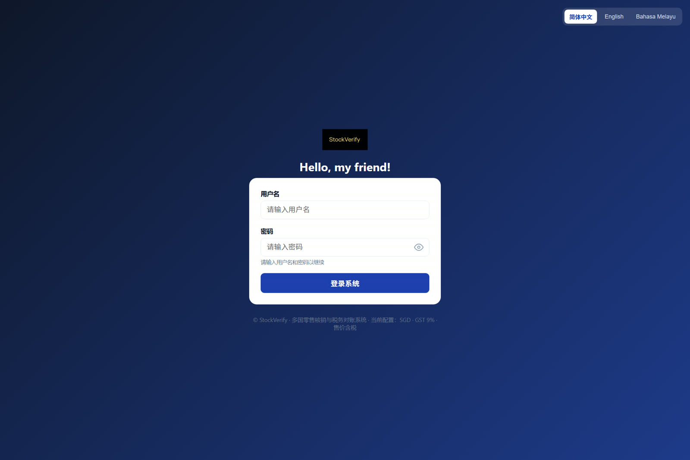

Covers a five-level authorization chain (super admin → admin → master distributor → distributor → merchant): tiered product catalog authorization, shipping & stock-in, barcode-based stock verification, inventory management, profit-sharing reconciliation, and tamper-proof audit logs. Offline records are queued locally and synced on reconnect. Multi-country tax schemes and currencies are configured by admins. Operation logs are protected by a SHA-256 hash chain.

Installable to mobile home screen as a PWA.

> **Solo project** — requirements, architecture, backend API, PWA frontend, unit tests and deployment all by one person.

## Highlights

- 🌐 **Five-level authorization chain** — Product catalogs are created by super admin and authorized hierarchically (super admin → admin → master distributor → distributor → merchant) via `authorized_by` + `level`. Revocation uses **recursive cascade delete** rather than soft delete: once upstream loses authorization, downstream products have no valid basis, and retaining them would enable cross-level privilege escalation. The authorization tree is filtered server-side by role.
- 📦 **Product catalog & distribution** — Super admin creates catalog templates → tiered authorization → merchant operations; full tracking of shipping orders, stock-in orders, and product entries.
- 📷 **Barcode verification** — Stock-in/out via phone camera scanning product barcodes; no dedicated scanner required.
- 📴 **Offline-first** — Disconnected records are written to IndexedDB and auto-synced on reconnect. The challenge: network flapping can deliver the same request twice. Solution: each offline record carries a `clientRecordId`; the server de-duplicates by this ID, making sync naturally idempotent (iOS Safari compatible, no Background Sync dependency).
- 🌏 **Multi-country tax** — Country / currency / tax type / tax rate fully configurable; supports both tax-inclusive and tax-exclusive pricing models.
- 🔐 **Multi-tenant isolation** — All queries force-filtered by shop; cross-shop access returns 403 from the server.
- 🧾 **One-click reconciliation** — Export Excel reports including platform/merchant profit split, commission, and commission surtax.
- 🔗 **Tamper-proof audit** — Operation logs are stored as a SHA-256 hash chain (each record contains the previous hash). Any single-line change breaks the chain, immediately exposed by `/api/logs/verify` — stronger trust than an ordinary log table.

## Project Scale

Solo project: ~1 week of development (2026-09) + 5 days of open-sourcing and refinement (2026-10-05 to 10-10, 20+ commits):

| Dimension | Value |
|-----------|-------|
| Total lines of code | ~9,200 (backend 3,545 + frontend 5,513 + PWA sw.js 147, excluding vendor and tools/) |
| API routes | 89 (v1: 15 + legacy: 74) |
| Database tables | 13 |
| Unit tests | 10 cases (zero-dependency `node:test`) |
| Docs & screenshots | 6 docs · 10 feature screenshots |

## Screenshots

| Login | Home |
|:----:|:----:|
|  | 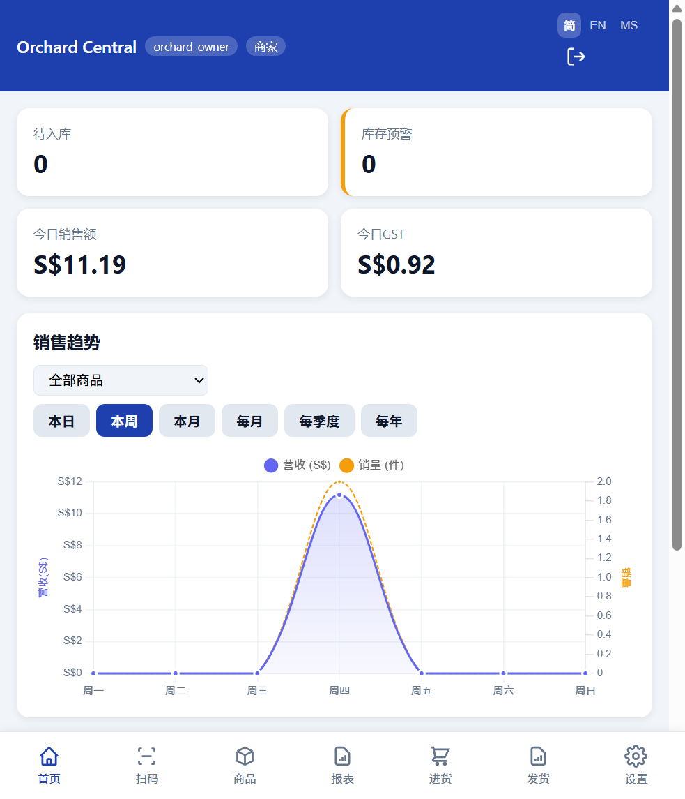 |
| **Scan In** | **Scan Out** |
| 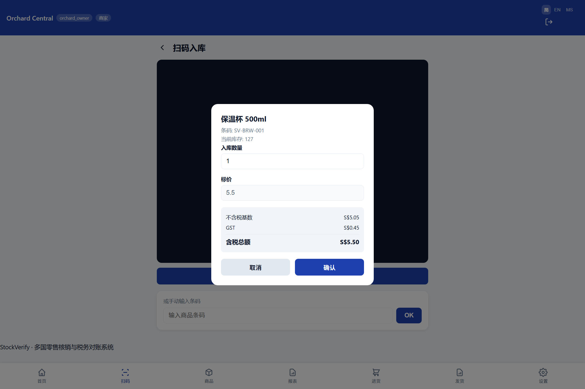 | 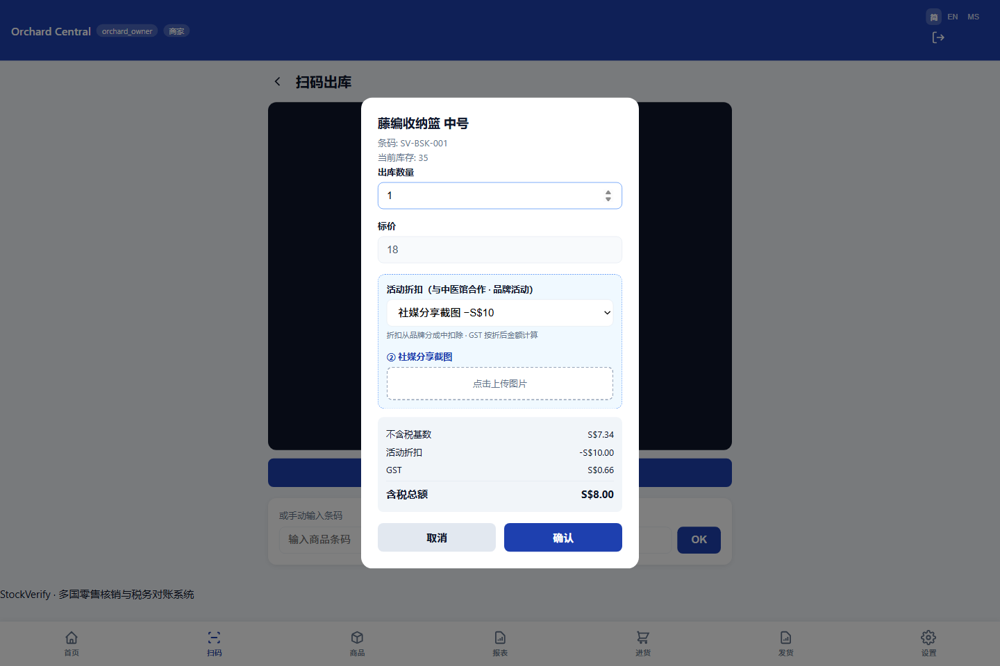 |
| **Inventory** | **Offline Mode** |
| 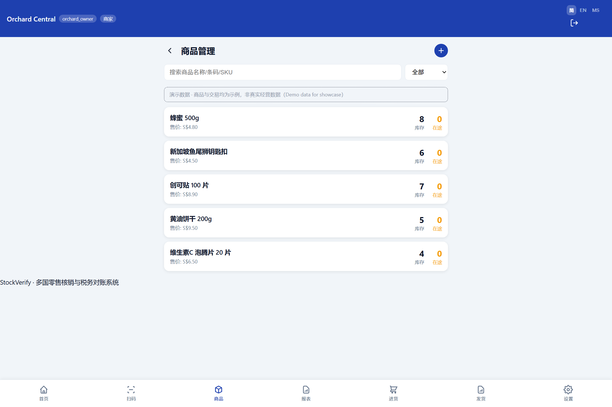 | 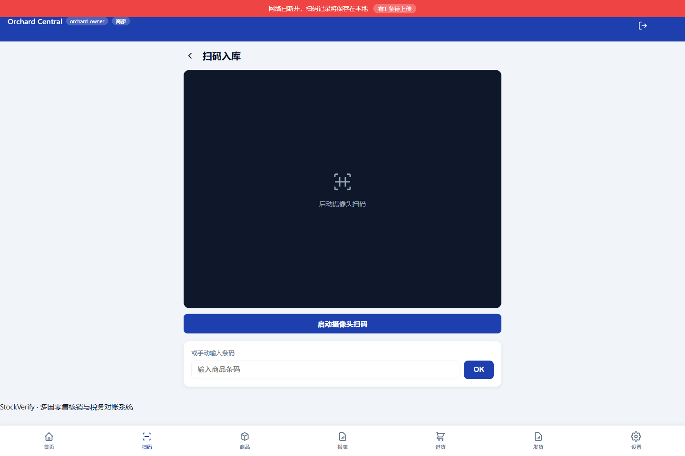 |
| **Report** | **Audit Logs** |
| 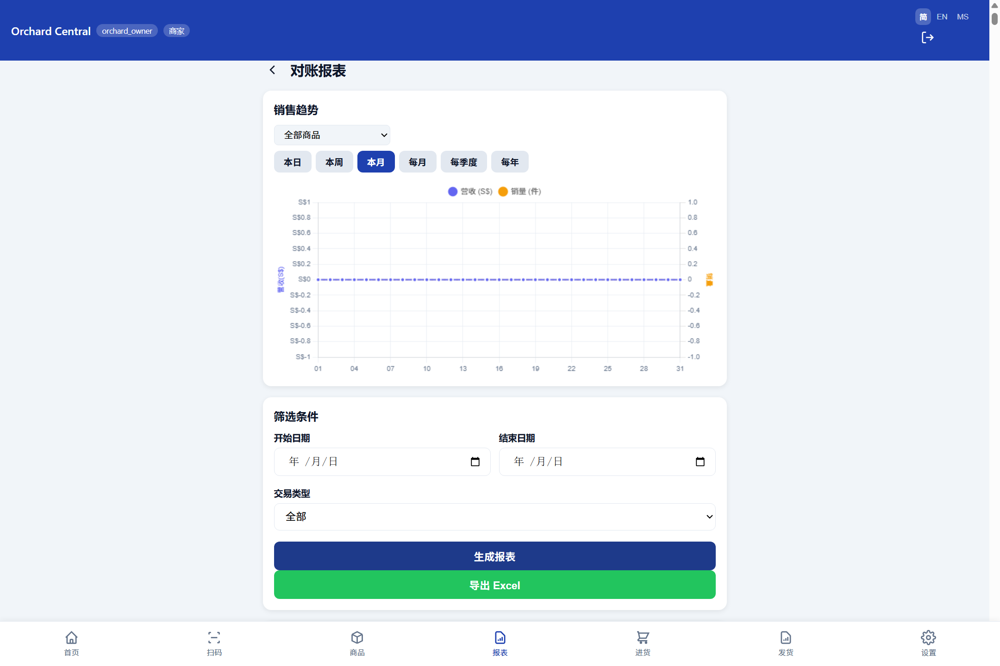 | 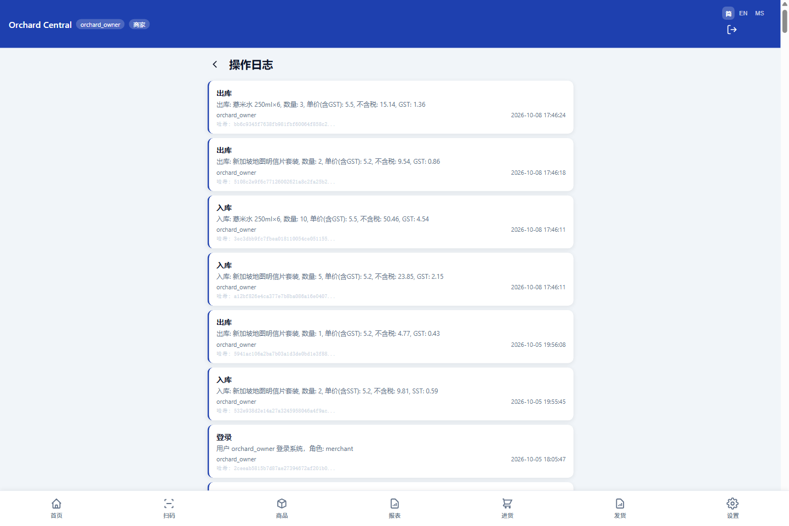 |
| **Admin Products** | **Admin Settings** |
| 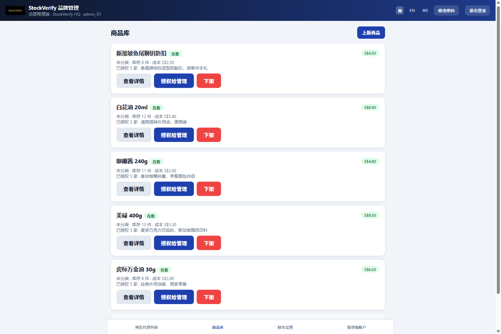 | 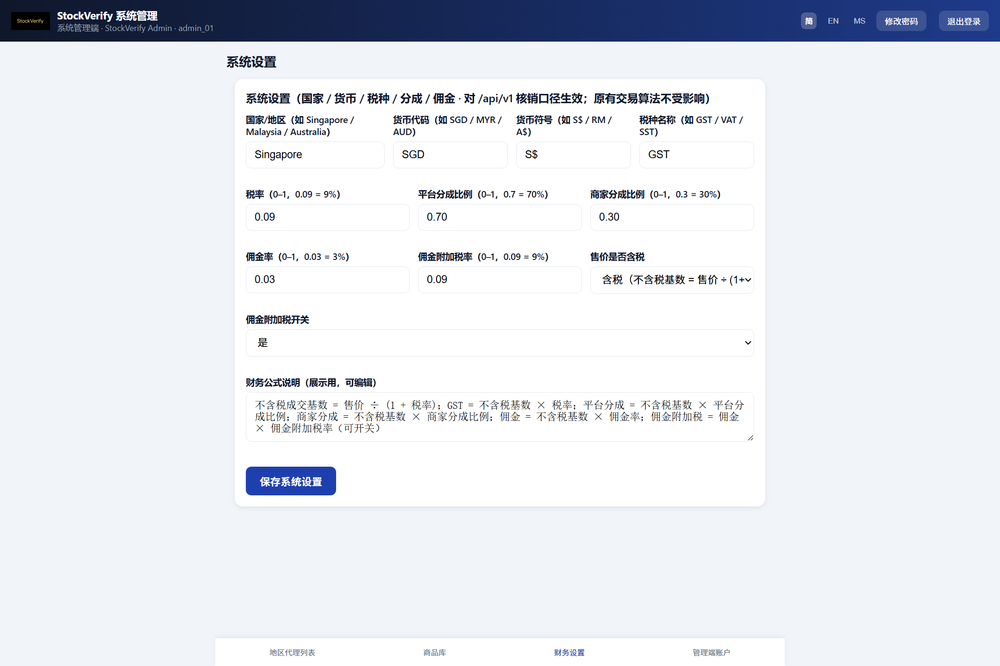 |

## Tech Stack

**Backend** — Node.js ≥ 20 · Express · SQLite (node-sqlite3-wasm) · JWT · bcrypt · ExcelJS

**Frontend** — Vanilla HTML / CSS / JavaScript (no framework) · html5-qrcode · SheetJS · IndexedDB

**PWA** — Web App Manifest · Service Worker · offline fallback · installable to desktop

**Permission model** — JWT + RBAC (staff / merchant / brand / admin) · tiered catalog authorization chain · server-side 403

**Why these choices** — SQLite over PostgreSQL because the target scenario is single-store / small chains: single file + zero-ops wins; no frontend framework because PWA startup overhead must stay minimal — vanilla JS measured Lighthouse Performance 97.

**System Architecture**

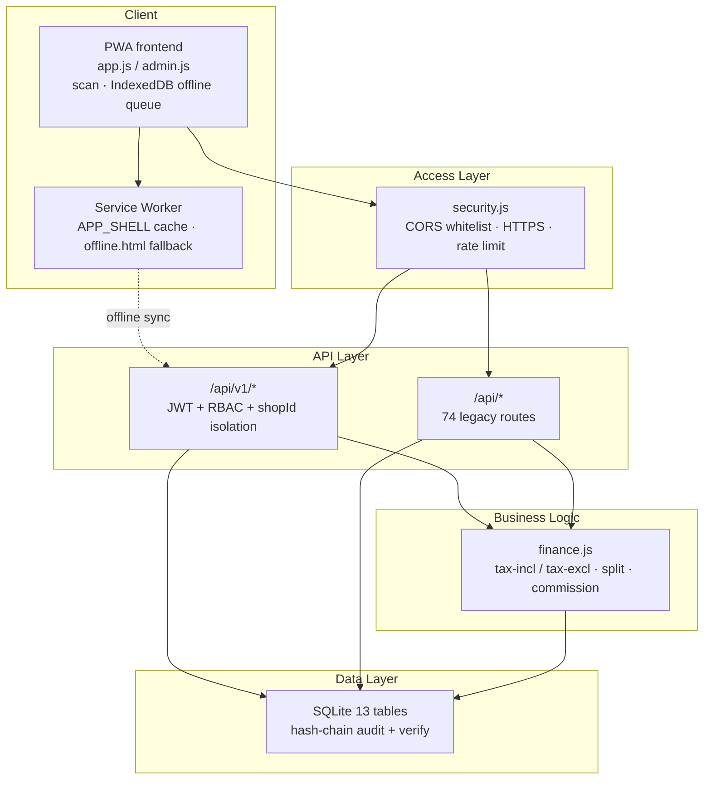

## Getting Started

```bash
git clone https://github.com/olise366oi/stockverify.git
cd stockverify
npm install
npm start           # open http://localhost:3000
npm test            # run unit tests (node:test, zero dependencies)
```

Initial account: see [docs/INIT.md](docs/INIT.md).

## Quality Metrics (Lighthouse)

| Category | Score |
|----------|-------|
| Performance | 97 |
| Accessibility | 97 |
| Best Practices | 100 |
| SEO | 100 |

PWA installability — installable-manifest ✅ · maskable-icon ✅ · splash-screen ✅ · themed-omnibox ✅

Offline verification (Playwright automation) — cached pages return normally when disconnected; navigation without cache falls back to offline.html

## Testing

```bash
npm test        # node:test, zero dependencies
```

10 test cases covering 2 pure-function modules:

| Module | Cases | Coverage |
|--------|-------|----------|
| `finance.js` `round2` | 7 | integers / two-decimal / rounding-up / float noise (`0.1+0.2`) / negatives / large numbers / tiny values to zero |
| `security.js` `makeRateLimit` | 3 | 20 requests pass / 21st returns 429 / different prefixes (per-endpoint) isolated |

Chose `node:test` over Jest / Vitest because the project has zero frontend build and zero babel — Node 22's built-in `node:test` + `node:assert` is sufficient without adding dependencies.

Planned: `calculate` (tax-inclusive/exclusive dual mode + profit split + commission; requires mocking `database.js`) and `validatePasswordStrength` (requires exporting the function from `server.js`).

## Security Design

| Layer | Measure |
|-------|---------|
| Authentication | JWT (12h) + bcrypt hashing; login rate-limited to 20 attempts per 5 minutes (v1 and legacy endpoints counted independently) |
| Secret management | `JWT_SECRET` is mandatory in production — server refuses to start if missing; never hardcoded |
| Multi-tenant | All queries carry `WHERE shop_id = ?`; unauthorized access returns 403 from the server |
| Role permissions | `requireRole` / `requireAdmin` enforced server-side; staff cannot access merchant/admin endpoints |
| Product authorization chain | Five-level authorization (super admin → admin → master distributor → distributor → merchant); revocation recursively cascade-deletes downstream; authorization tree filtered server-side by role |
| Transport | Force HTTPS (301) · HSTS · X-Content-Type-Options · X-Frame-Options |
| CORS | Same-origin by default; production whitelist configured via `CORS_ORIGINS` env var |
| Audit | Operation logs stored as SHA-256 hash chain; `/api/logs/verify` validates integrity |
| Upload | Image type whitelist · 3MB limit · randomized filenames · nosniff |

> Note: login rate limiting is implemented as single-instance in-memory storage (`security.js` module-level Map); for multi-instance horizontal scaling, replace with shared storage (e.g., Redis).

## Limitations & Reflections

Solo project — the following are known gaps or areas that are not yet fully polished:

- **Rate limiting is single-instance in-memory** — `security.js` uses a module-level `Map`; multi-instance horizontal scaling requires replacing it with shared storage such as Redis
- **Offline sync uses last-write-wins** — no conflict merging when multiple devices modify the same product simultaneously; the later write overwrites the earlier one. Conflict detection is not implemented
- **Two parallel routing systems** — `server.js` still has 74 legacy routes not yet migrated to `/api/v1/*`; `routes-v1.js` is the new canonical layer. Migration is incomplete
- **Frontend not modularized** — `public/js/app.js` (1,598 lines) and `admin.js` (2,609 lines) remain single files; further splitting would require a build step, deferred for now
- **Limited unit test coverage** — 10 cases cover only 2 pure-function modules; core `calculate` (tax-inclusive/exclusive dual mode + profit split + commission) and `validatePasswordStrength` are not yet covered, as they require mocking `database.js`
- **Audit chain verification is single-process** — hash-chain integrity check via `/api/logs/verify` works within a single instance; distributed verification is not implemented
- **No online demo** — reviewers must run `npm start` locally; not deployed to any cloud platform

## Documentation

- [docs/architecture.md](docs/architecture.md) — Architecture overview
- [docs/CHANGELOG.md](docs/CHANGELOG.md) — Change log

<details>
<summary><b>API Reference</b> (click to expand)</summary>

| Method | Path | Description |
|--------|------|-------------|
| POST | /api/v1/login | Login, returns token |
| GET | /api/v1/products | Product list (filtered by shop) |
| POST | /api/v1/scan/in | Barcode stock-in |
| POST | /api/v1/scan/out | Barcode stock-out |
| POST | /api/v1/sync | Offline record batch sync |
| GET | /api/v1/logs | Operation logs (shop-filtered + role-restricted) |
| GET | /api/v1/export/excel | Export reconciliation report |
| GET | /api/v1/config | Business config (public, no sensitive data) |
| GET / PUT | /api/v1/admin/settings | System settings (admin required) |
| GET / POST / PUT / PATCH | /api/v1/admin/products | Product management (admin required) |

</details>

<details>
<summary><b>Environment Variables</b> (click to expand)</summary>

```bash
PORT=3000                           # server port (default 3000)
JWT_SECRET=<32+ char random>        # REQUIRED in production; server refuses to start if missing
NODE_ENV=production                 # marks production; enables JWT_SECRET enforcement
CORS_ORIGINS=                       # CORS whitelist (comma-separated; empty = same-origin only)
DATABASE_PATH=data/inventory.db     # SQLite path (optional)
```

Generate JWT_SECRET:

```bash
node -e "console.log(require('crypto').randomBytes(48).toString('hex'))"
```

The project uses dotenv to load .env; .env is excluded by .gitignore.

</details>

<details>
<summary><b>Project Structure</b> (click to expand)</summary>

```text
server.js        Express entry, middleware, legacy /api/* routes
routes-v1.js     API v1 routes (/api/v1/*)
config.js        Environment variables & JWT_SECRET management
security.js      Shared rate limiter (per-endpoint isolated counting)
database.js      SQLite init, audit chain write & verification
finance.js       Tax / profit split / commission calculation
public/          PWA frontend (HTML / CSS / JS / sw.js / manifest.json)
docs/            Architecture docs, CHANGELOG, screenshots
```

</details>

## Version

Current version v0.3.4 — see [docs/CHANGELOG.md](docs/CHANGELOG.md) for changes.

Released under the MIT License — see [LICENSE](LICENSE).
