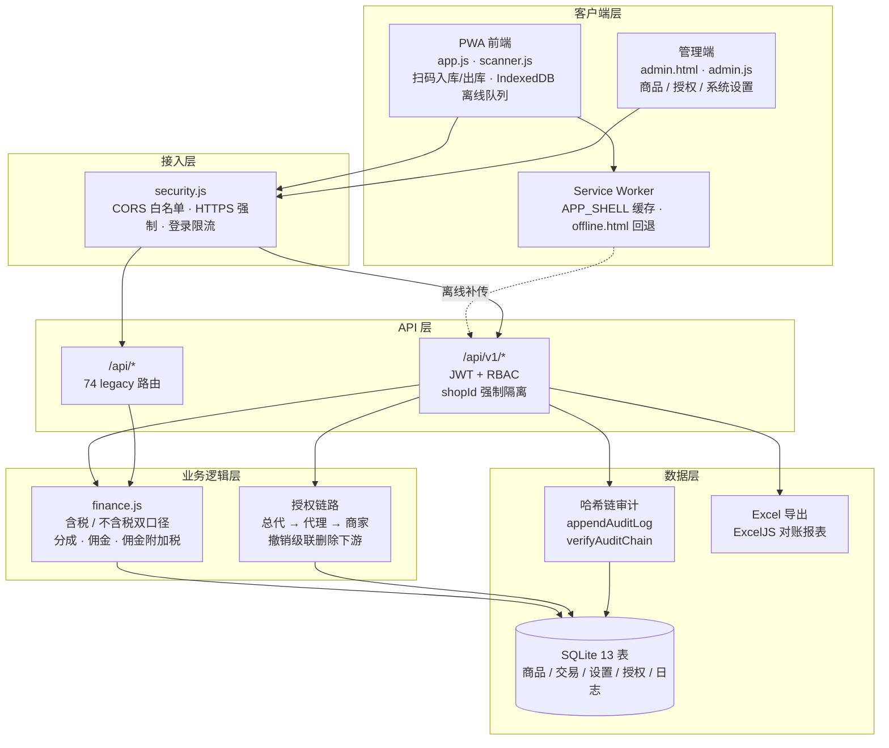
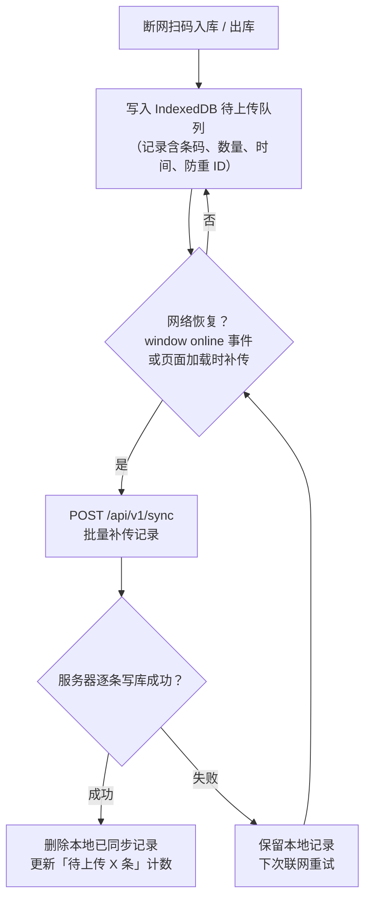

# StockVerify — 系统架构与离线同步

> 当前版本 v0.3.4 · 多国零售分销库存系统（PWA）
> 所有税务 / 货币 / 分成参数均由管理端配置，支持多国、多税制、多货币。

## 一、总体架构

**说明**

- 客户端为 PWA：首次访问后可离线打开，扫码入库 / 出库在断网时写入 IndexedDB 待上传队列；管理端支持商品 / 授权链路 / 系统参数配置。
- 接入层统一处理跨域白名单、HTTPS 强制与登录限流（`security.js`，legacy 与 v1 独立计数）。
- API 分两层：`/api/v1/*` 为规范化新接口（JWT + RBAC + 按 `shopId` 强制隔离）；`/api/*` 为 74 条 legacy 路由，待逐步迁移。
- 业务逻辑层：财务口径由 `finance.js` 统一计算（含税 / 不含税、分成、佣金、佣金附加税）；商品授权按「总代 → 代理 → 商家」分层，撤销时递归级联删除下游。
- 数据层：SQLite 13 表支撑商品 / 交易 / 设置 / 授权 / 日志；操作日志以 SHA-256 哈希链存储，`/api/logs/verify` 可校验完整性；对账报表经 ExcelJS 导出。

## 二、离线同步流程

**说明**

- 不依赖 iOS Safari 不支持的 Background Sync：同时监听 `window online` 事件，并在页面加载时主动补传。
- 每条记录带 `clientRecordId`，服务端按此防重，重复补传自动跳过。
- 页面顶栏实时显示「待上传 X 条」，联网后自动清空。
