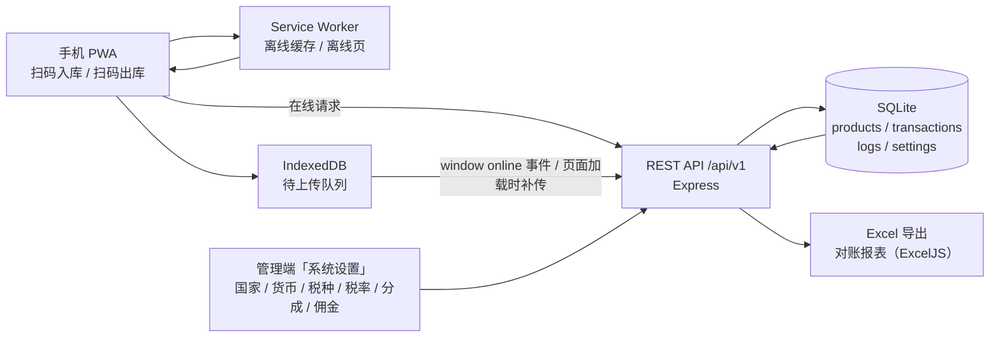
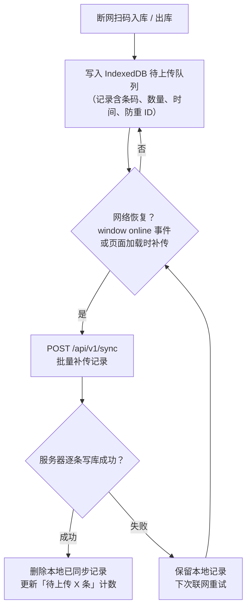

# StockVerify — 系统架构与离线同步

> 当前版本 v0.2.0 · 多国零售核销与税务对账系统
> 所有税务 / 货币 / 分成参数均由管理端配置，支持多国、多税制、多货币。

## 一、总体架构

**说明**

- 客户端为 PWA：首次访问后可离线打开，扫码入库 / 出库在断网时写入 IndexedDB 待上传队列。
- 服务端为 Express + SQLite：`/api/v1` 提供登录、商品、扫码核销、离线同步、日志、Excel 导出。
- 财务口径统一由服务端计算，参数来自 `settings` 表（管理端可配置），`config.json` 仅作缺省默认值。
- 管理端「系统设置」支持国家 / 地区、货币代码与符号、税种名称、税率、平台 / 商家分成比例、佣金率、佣金附加税率、售价是否含税等配置；切换后扫码核销按新参数计算。

## 二、离线同步流程

**说明**

- 不依赖 iOS Safari 不支持的 Background Sync：同时监听 `window online` 事件，并在页面加载时主动补传。
- 每条记录带 `clientRecordId`，服务端按此防重，重复补传自动跳过。
- 页面顶栏实时显示「待上传 X 条」，联网后自动清空。
